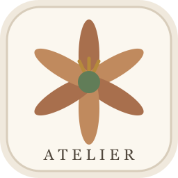
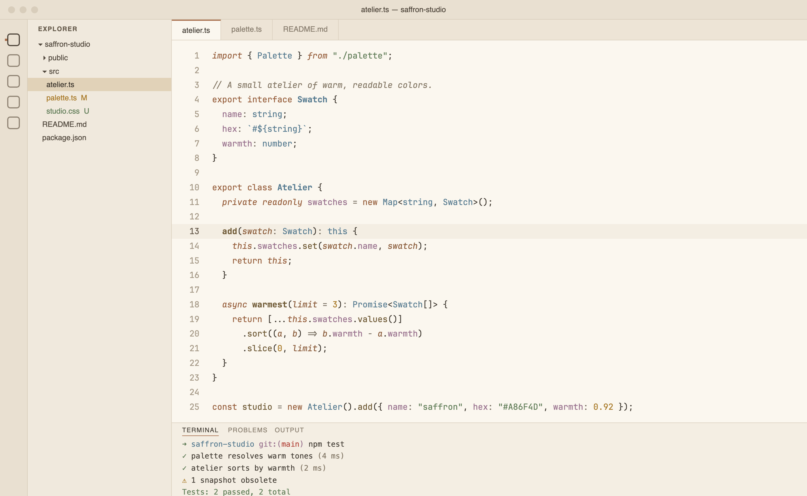

<p align="center">
  
</p>

<h1 align="center">Saffron Atelier</h1>

<p align="center">
  A warm cream-and-beige light theme for VS Code with readable charcoal text and muted olive, soft blue, terracotta and gold accents.
</p>

<p align="center">
  <a href="https://github.com/vasikmansuri/saffron-atelier-vscode-theme/releases/latest"></a>
  <a href="LICENSE"></a>
</p>



---

## Contents

- [Palette](#palette)
- [Installation](#installation)
  - [macOS](#macos)
  - [Windows](#windows)
  - [Linux](#linux)
  - [Build from source](#build-from-source-any-os)
- [Activate the theme](#activate-the-theme)
- [Recommended fonts](#recommended-fonts)
- [Updating and uninstalling](#updating-and-uninstalling)
- [License](#license)

## Palette

| Role | Hex |
|---|---|
| Editor background | `#FBF7EF` |
| Sidebar / panel | `#F0E9DD` |
| Text | `#403A32` |
| Accent (terracotta) | `#A86F4D` |
| Keywords | `#98613F` |
| Functions | `#6F5A36` |
| Strings (olive) | `#617D58` |
| Types (soft blue) | `#587C91` |
| Numbers (gold) | `#A87927` |
| Properties (mauve) | `#98718D` |
| Comments | `#857967` |

## Installation

First download **`saffron-atelier-x.y.z.vsix`** from the [latest release](https://github.com/vasikmansuri/saffron-atelier-vscode-theme/releases/latest).

**Any OS, using the VS Code UI:** open the Extensions view (`Ctrl+Shift+X` / `Cmd+Shift+X`), click the `...` menu at the top, choose **Install from VSIX...**, and select the downloaded file.

You can also install it from the terminal, as shown below for each OS.

### macOS

```bash
# Optional: makes the `code` command available in your shell.
# In VS Code: Cmd+Shift+P → "Shell Command: Install 'code' command in PATH"

code --install-extension ~/Downloads/saffron-atelier-1.2.0.vsix
```

### Windows

In PowerShell (the `code` command is added to PATH by the VS Code installer):

```powershell
code --install-extension "$env:USERPROFILE\Downloads\saffron-atelier-1.2.0.vsix"
```

### Linux

```bash
code --install-extension ~/Downloads/saffron-atelier-1.2.0.vsix
```

> **VSCodium / Cursor / other VS Code forks:** use `codium --install-extension ...` or `cursor --install-extension ...` instead of `code`.

### Build from source (any OS)

Requires [Node.js](https://nodejs.org/) 18+ and Git.

```bash
git clone https://github.com/vasikmansuri/saffron-atelier-vscode-theme.git
cd saffron-atelier-vscode-theme
npx @vscode/vsce package
code --install-extension saffron-atelier-1.2.0.vsix
```

## Activate the theme

1. Open the Command Palette: `Cmd+Shift+P` (macOS) or `Ctrl+Shift+P` (Windows/Linux).
2. Run **Preferences: Color Theme**.
3. Select **Saffron Atelier**.

Or add this to your `settings.json`:

```json
"workbench.colorTheme": "Saffron Atelier"
```

## Recommended fonts

VS Code themes can't set fonts, so add a font in `settings.json`. The theme uses italics for comments, parameters, modifiers and `this`/`self`, and bold for class and function declarations. Choose a font with a real italic.

**Recommended: [IBM Plex Mono](https://github.com/IBM/plex).** Its warm, humanist shapes suit the palette. Alternatives: [JetBrains Mono](https://www.jetbrains.com/lp/mono/), [Monaspace Radon / Argon](https://monaspace.githubnext.com/).

| OS | Install IBM Plex Mono |
|---|---|
| macOS | `brew install --cask font-ibm-plex-mono` |
| Windows | `winget install --id=IBM.Plex -e` or download from [GitHub releases](https://github.com/IBM/plex/releases), then right-click the `.ttf` files → **Install** |
| Ubuntu / Debian | `sudo apt install fonts-ibm-plex` |
| Fedora | `sudo dnf install ibm-plex-mono-fonts` |
| Arch | `sudo pacman -S ttf-ibm-plex` |

Restart VS Code after installing the font, then add:

```jsonc
{
  "workbench.colorTheme": "Saffron Atelier",
  "editor.fontFamily": "'IBM Plex Mono', 'JetBrains Mono', Menlo, Consolas, monospace",
  "editor.fontSize": 14,
  "editor.lineHeight": 1.7,
  "editor.fontLigatures": false,
  "editor.letterSpacing": 0.2,
  "terminal.integrated.fontFamily": "'IBM Plex Mono', 'JetBrains Mono', monospace",
  "terminal.integrated.fontSize": 13,
  "terminal.integrated.lineHeight": 1.3
}
```

> If you use JetBrains Mono or Monaspace, set `"editor.fontLigatures": true`.

## Updating and uninstalling

- **Update:** download the newer `.vsix` and install it the same way. It replaces the old version.
- **Uninstall:** `code --uninstall-extension vasikmansuri.saffron-atelier`, or use the gear icon on the extension in the Extensions view.

> **Seeing two "Saffron Atelier" entries?** Version 1.0.0 used the publisher `custom-local`. Uninstall it with `code --uninstall-extension custom-local.saffron-atelier`. If it's still listed, delete the `custom-local.saffron-atelier-1.0.0` folder in `~/.vscode/extensions` (Windows: `%USERPROFILE%\.vscode\extensions`).

## License

[MIT](LICENSE) © Vasik Mansuri
